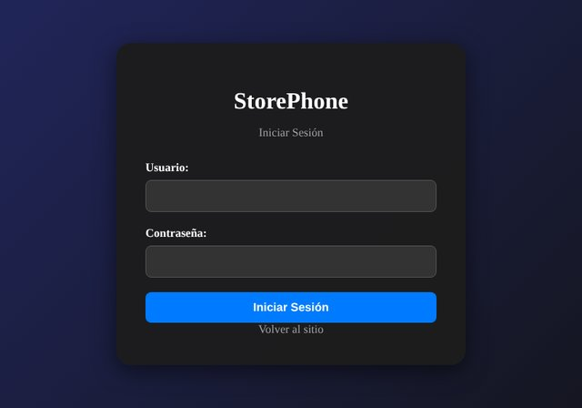

# StorePhone — Proyecto Final de Programación Web

Sitio web de una tienda de celulares con un formulario de contacto público y un panel de gestión de usuarios protegido por **autenticación con roles** (administrador / usuario). Incluye API REST propia con Node.js + Express y persistencia en SQLite.

<p align="center">
  
  
</p>

## Funcionalidades

- Sitio público con secciones de inicio, ofertas, catálogo y contacto.
- Formulario de contacto que registra usuarios (con validación en cliente y servidor).
- Inicio de sesión con sesiones del lado del servidor y dos roles:
  - **Administrador:** ve, edita y elimina usuarios (CRUD completo).
  - **Usuario:** ve la lista de usuarios en modo solo lectura.
- API REST con control de acceso por rol en cada endpoint.

## Tecnologías

| Capa | Stack |
|---|---|
| Backend | Node.js, Express |
| Base de datos | SQLite3 |
| Frontend | TypeScript, HTML5, CSS3 |
| Autenticación | express-session, bcrypt |
| Seguridad | express-rate-limit, dotenv |

## Instalación

**Requisitos:** Node.js 20.17 o superior.

1. Instalar dependencias:
   ```bash
   npm install
   ```

2. Crear el archivo de configuración a partir del ejemplo:
   ```bash
   cp .env.example .env
   ```
   Completar en `.env`:
   - `SESSION_SECRET`: cadena aleatoria de al menos 32 caracteres. Para generarla:
     ```bash
     node -e "console.log(require('crypto').randomBytes(48).toString('hex'))"
     ```
   - `SEED_ADMIN_PASSWORD` y `SEED_USER_PASSWORD`: contraseñas de las cuentas de prueba (elegí las tuyas).

3. Crear las tablas y las cuentas de prueba:
   ```bash
   npm run seed
   ```
   > ⚠️ El script **vacía** las tablas `usuarios` y `cuentas` antes de cargar los datos. Usalo solo para inicializar.

4. Iniciar el servidor:
   ```bash
   npm start
   ```

5. Abrir http://localhost:3000/StorePhone.html

> Es necesario entrar por `localhost:3000`. Abrir el HTML directamente desde el disco produce errores de CORS.

## API

| Método | Ruta | Acceso | Descripción |
|---|---|---|---|
| POST | `/api/login` | Público (limitado) | Inicia sesión |
| POST | `/api/logout` | Sesión | Cierra sesión |
| GET | `/api/session` | Público | Estado de la sesión actual |
| GET | `/api/usuarios` | Usuario o admin | Lista usuarios |
| POST | `/api/usuarios` | Público (limitado) | Registra un usuario (formulario de contacto) |
| PUT | `/api/usuarios/:id` | Admin | Edita un usuario |
| DELETE | `/api/usuarios/:id` | Admin | Elimina un usuario |

## Seguridad

Decisiones tomadas en el proyecto:

- **Contraseñas con bcrypt** (hash con sal), nunca en texto plano.
- **Sin secretos en el código:** el secreto de sesión y las contraseñas de prueba salen de variables de entorno (`.env` está en `.gitignore`). El servidor no arranca sin un `SESSION_SECRET` válido.
- **Consultas SQL parametrizadas** en todos los accesos a la base (previene inyección SQL).
- **Prevención de XSS:** los datos de usuario se escapan antes de mostrarse en el panel de administración.
- **Fuerza bruta y spam:** límite de intentos por IP en el login (10 cada 15 minutos) y en el formulario público (20 por hora).
- **Sesiones:** cookie `HttpOnly` y `SameSite=Lax` (`Secure` en producción) y regeneración del ID de sesión al iniciar sesión (evita *session fixation*).
- **Validación en el servidor** de formato de email y longitud máxima de los campos, además del límite de tamaño del cuerpo de las peticiones.
- **Dependencias auditadas:** `npm audit` sin vulnerabilidades conocidas.

## Estructura del proyecto

```
├── backend/
│   ├── db.js          # Conexión y creación de tablas de SQLite
│   ├── server.js      # Servidor Express y API REST
│   ├── migrate.js     # Inicialización de datos y cuentas de prueba
│   └── datos.json     # Datos de ejemplo (vacío por defecto)
├── frontend/
│   └── main.ts        # Lógica del cliente en TypeScript
├── docs/              # Capturas para este README
├── img/               # Imágenes del sitio
├── StorePhone.html    # Página principal
├── login.html         # Inicio de sesión
├── .env.example       # Plantilla de variables de entorno
└── package.json
```

## Scripts

| Comando | Descripción |
|---|---|
| `npm install` | Instala las dependencias |
| `npm run build` | Compila TypeScript a `dist/` |
| `npm run seed` | Inicializa la base de datos y las cuentas de prueba |
| `npm start` | Compila e inicia el servidor |

## Solución de problemas

- **"Falta SESSION_SECRET":** creá el archivo `.env` (paso 2 de la instalación).
- **Error al cargar usuarios en el panel:** verificá que hayas iniciado sesión y que entres por `http://localhost:3000/StorePhone.html`.
- **"address already in use":** el puerto 3000 está ocupado; cerrá el proceso anterior o cambiá `PORT` en `.env`.
- **"Demasiados intentos":** se activó el límite de login; esperá 15 minutos.
